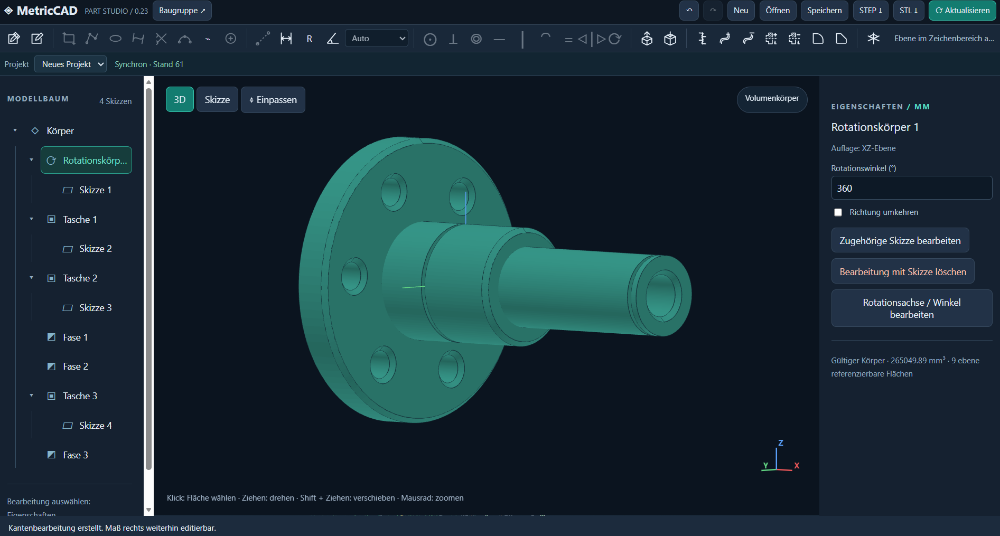

# MV_CAD

**Parametric 3D CAD with a local browser interface and optional AI-assisted modeling.**

Create dimensioned sketches, build editable 3D parts, and combine them in assemblies. Model by hand, or connect an AI assistant through the Model Context Protocol (MCP) to work on the same Part Studio projects.

An open-source project by [**MetricVision GmbH**](https://metricvision.at).

<!-- SCREENSHOT: Add docs/images/metriccad-interface.png, then remove the comment markers around the image below in both READMEs. Use a real screenshot with a 3D part and the feature tree visible. -->


## What you can do

- **Sketch with dimensions and constraints:** define geometry and check its remaining degrees of freedom.
- **Build parametric parts:** extrude, cut pockets, revolve, add fillets and chamfers, and sweep profiles along helices.
- **Work with assemblies:** place parts and connect them with fixed, revolute, or slider joints.
- **Save and export:** retain the feature tree in native JSON, or export part geometry as STEP/STL and assemblies as STEP.
- **Let AI do the modeling:** connect an MCP-compatible AI client such as Claude Code or the Codex CLI and describe the part you want. Your assistant can create sketches, apply dimensions and constraints, build 3D features, and inspect the result. It uses the same native modeling operations available in the manual interface, so you can open the sketches, change dimensions, and continue modeling by hand.

**AI is optional.** Manual CAD modeling works without an AI client or account. The application runs on your computer; the browser is its interface. AI tools currently control Part Studio projects; assemblies are edited manually. The current interface is in German.

## Quick start

Recommended: **Python 3.12, 64-bit**, and a browser with WebGL support.

Clone this repository or choose **Code → Download ZIP** and extract it. Open a terminal in the folder containing `app.py` and `requirements.txt`.

**Windows — PowerShell**

```powershell
py -3.12 -m venv .venv
.venv\Scripts\python.exe -m pip install -r requirements.txt
.venv\Scripts\python.exe app.py
```

**macOS / Linux**

```bash
python3.12 -m venv .venv
.venv/bin/python -m pip install -r requirements.txt
.venv/bin/python app.py
```

The browser opens at **http://127.0.0.1:8765**. Keep the terminal running while using the application. Stop the server with **Ctrl+C**.

## Let AI Do the Work

MetricCAD exposes its modeling tools through the Model Context Protocol (MCP).
You can connect MCP-compatible AI clients such as Claude Code or the Codex CLI.

For example, ask your assistant to create a part, fully constrain its sketches, and inspect the result. You can then continue editing it manually. Through the MV_CAD MCP integration, the AI assistant works with the same modeling operations available in the manual interface.

## Project status

MetricCAD is an **early version for testing and feedback**.

- Models are limited to 50 features; additional sketch and geometry limits apply.
- Fillets and helix sweeps have geometry-dependent limitations.
- Drawing sheets with arranged views and title blocks are not included.
- The intended setup is a local, single-user application. Public hosting and multi-user operation are not supported deployment targets for this release.
- Full browser/WebGL integration testing remains unverified.

Check geometry, dimensions, and exported files before using them for manufacturing.

## Documentation and feedback

| Resource | What it covers |
|---|---|
| [Modeling guide](docs/MODELING_GUIDE.md) | Units, stable references, constraints, and an MCP modeling workflow |
| [Contributing](CONTRIBUTING.md) | Bug reports and code contributions; currently in German |
| [Security](SECURITY.md) | Private reporting of security issues; currently in German |

Found a bug or have a feature idea? [Open an issue](https://github.com/metricvision/MV_CAD/issues) with your operating system, Python version, reproduction steps, and a small example you can share publicly. Keep credentials, confidential designs, and `.metriccad` files out of reports. Send security issues privately to [office@metricvision.at](mailto:office@metricvision.at).

## About MetricVision

[**MetricVision GmbH**](https://metricvision.at) develops custom software, algorithms, and AI integrations for technical and scientific workflows.

## License

Copyright 2026 MetricVision GmbH. Original project code is licensed under [Apache-2.0](LICENSE); see [NOTICE](NOTICE).

Dependencies are installed separately and retain their own licenses. See [third-party notices](THIRD_PARTY_NOTICES.md) for the documented dependency inventory and its scope.
